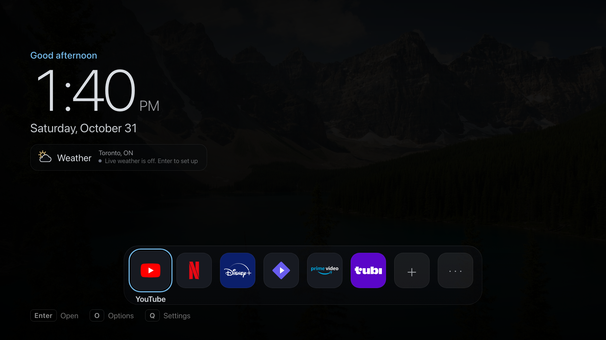

# Premium Home for LG webOS TVs

A clean, photo-led home screen for LG OLED TVs (built and tested on a 2024 C4, webOS 25), installed through LG's official Developer Mode. No root, no firmware changes, and LG's own Home stays one triple-press away.



**What it does**
- A full-screen landscape photo, a large clock and date, a personal greeting ("Good evening, Alex & Sam"), optional live weather (Open-Meteo, °C, opt-in), and a compact dock of your real apps.
- Real launches: YouTube, Netflix, Disney+, Prime Video, Stremio, Tubi, Live TV, the web browser, HDMI 1–4 and LG Home, through webOS's own Application Manager. Anything not installed says so instead of pretending.
- An OLED-conscious schedule: ambient view after 90 s, a new photo every 10 min, a deep dim at 45 min, pure black at 60 min. LG's own screensaver and OLED care stay in charge (the app asks for LG's 30-minute screensaver mode; it never fakes input to hold the screensaver off).
- Settings for all of it, export/import, a wallpaper gallery of public-domain and CC-BY photos with credits, and a "TV cleanup" page that reports honestly which optional LG apps are installed.
- Optional: a **Home-button helper** so the remote's Home key opens Premium Home (press again for ambient, triple-press for LG Home). This takes over the remote's input and is **experimental**: read [docs/HELPER.md](docs/HELPER.md) before using it.

**What it is not**
- Not a replacement for LG's firmware or Home. Developer Mode apps disappear if the Developer Mode session expires; you re-extend it in LG's Developer Mode app and reinstall if needed.
- Not able to uninstall LG's store apps, read or change LG's settings, or turn the panel off. It never tries.
- Not affiliated with LG, Google, Netflix, Disney, Amazon, Tubi, Stremio, Twitch, Microsoft or Nvidia.

## Install (about 20 minutes)
See [docs/INSTALL.md](docs/INSTALL.md). In short: turn on Developer Mode on the TV, install LG's CLI on your computer, `ares-setup-device`, then

```bash
cd launcher
python3 -I tools/fetch-logos.py          # optional: brand logos, downloaded on your machine
python3 -B tools/package-ipk.py          # builds dist/local.lgc4.premiumhome_<version>_all.ipk
tools/webos-cli/node_modules/.bin/ares-install --device <your-tv> dist/local.lgc4.premiumhome_*_all.ipk
```

## Project layout
| Folder | What |
|---|---|
| `launcher/app` | The web app (plain HTML/CSS/JS, no build step) |
| `launcher/tests` | 43 unit tests (`node --test tests/config.test.js`) and 44 browser tests (`python3 -B tools/run-browser-tests.py`, needs Chrome) |
| `launcher/tools` | packaging, logo fetcher, preview server, screenshot tools |
| `helper/` | The optional Home-button helper: source, reproducible Docker build, 110 simulated-scenario tests, risk report |
| `docs/` | install, helper, recovery |

## Licences
MIT for this project (see [LICENSE](LICENSE)). The helper is a fork of [Clean Your TV for LG webOS](https://github.com/Razdva122/clean-your-tv-lg-webos) (MIT). Photos: public domain / CC0 / CC BY, credited in the app and in `launcher/ASSET-LICENSES.md`. Weather: [Open-Meteo](https://open-meteo.com) (CC BY 4.0). Brand logos are trademarks of their owners and are not in this repository; `tools/fetch-logos.py` downloads them from their public sources on your own machine.

Made by [@hhemeid](https://github.com/hhemeid).
